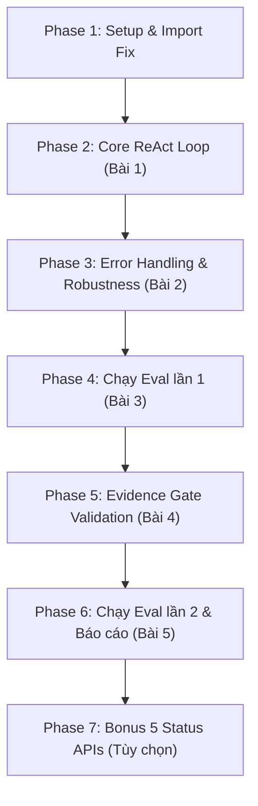

# Kế hoạch Triển khai Chi tiết: Xây dựng ReAct Loop Agent từ A đến Z

Tài liệu này hướng dẫn bạn từng bước tự tay code hoàn thiện **ReAct Loop Agent** trong file `agent.py`, vượt qua toàn bộ unit tests, chạy evaluation 2 lần và hoàn thiện báo cáo lab `NOTES.md`.

---

## 🗺️ Bản đồ lộ trình tổng quan



---

## 📌 Phase 1: Chuẩn bị Môi trường & Sửa các Import cơ bản

### 1. Mục tiêu
Chuẩn bị đúng cấu trúc import trong `agent.py` và kiểm tra môi trường chạy.

### 2. Gợi ý cần làm trong `agent.py`
- Kiểm tra các import ở đầu file `agent.py`:
  - `status_tools.py` cung cấp `SCHEMAS` (không phải `status_schema`).
  - `providers.py` cung cấp class `Provider` (file tên là `providers.py`, không phải `provider.py`).
  - Cần import `json` để parse argument và serialize kết quả tool.
- Khai báo hoặc giữ nguyên `SYSTEM_PROMPT` chuẩn được cung cấp.

```python
# Gợi ý import trong agent.py:
import json
from status_tools import SCHEMAS
```

---

## 🔄 Phase 2: Xây dựng Core ReAct Loop (Bài 1)

### 1. Mục tiêu
Implement hàm `run_agent(question, provider, tools, max_steps=6) -> dict`:
- Gửi tin nhắn đến LLM qua `provider.complete(messages, schemas)`.
- Nhận tool call, parse arguments, gọi `tools.execute(name, args)`.
- Trả kết quả tool về cho LLM với đúng `tool_call_id`.
- Trả về câu trả lời cuối cùng khi LLM kết thúc.

### 2. Contract Input & Output của `run_agent`
```python
def run_agent(question, provider, tools, max_steps=6) -> dict:
    # Trả về dict có cấu trúc:
    # {
    #     "status": "completed" | "max_steps" | "error",
    #     "answer": str,
    #     "trace": list[dict],
    #     "usage": list[dict],
    #     # "error": str (khi status == 'error')
    # }
```

### 3. Cấu trúc Trace (Rất quan trọng cho Test & Eval)
Mỗi sự kiện trong `trace` là một dict có key `event`.
Khi thực thi tool, trace phải có dạng:
```python
{
    'event': 'tool',
    'step': step,               # int: 1, 2, ...
    'name': tool_name,          # str: tên tool được gọi
    'arguments': args,          # dict hoặc giá trị args đã parse
    'result': result            # dict: kết quả từ tools.execute()
}
```

### 4. Gợi ý thiết kế thuật toán từng bước (Pseudocode)

1. **Khởi tạo trạng thái**:
   - `trace = []` (danh sách lưu sự kiện debug/chấm điểm).
   - `usages = []` (danh sách lưu token usage từ mỗi lần complete).
   - Lấy system prompt (mặc định là `SYSTEM_PROMPT`, hoặc `getattr(tools, 'system_prompt', SYSTEM_PROMPT)` để sau này hỗ trợ bonus).
   - Lấy tool schemas (mặc định là `SCHEMAS`, hoặc `getattr(tools, 'schemas', SCHEMAS)`).
   - `messages = [ {'role': 'system', 'content': sys_prompt}, {'role': 'user', 'content': question} ]`

2. **Vòng lặp Agent Step**:
   ```python
   for step in range(1, max_steps + 1):
   ```
   - **Bước 2.1: Gọi Provider**:
     - `response = provider.complete(messages, schemas)`
     - Lưu usage nếu có: `if response.get('usage'): usages.append(response['usage'])`
     - Lấy `assistant_message = response['message']`
     - Lấy `calls = response.get('calls', [])`
     - Lấy `finish = response.get('finish')`

   - **Bước 2.2: Append Assistant Message vào History**:
     > **Quan trọng**: `assistant_message` phải được append **nguyên vẹn** vào `messages` trước khi thêm bất kỳ kết quả tool nào!

   - **Bước 2.3: Xử lý các Tool Calls (nếu có `calls`)**:
     - Duyệt qua từng `call` trong `calls`:
       - Lấy `call_id = call['id']`, `tool_name = call['name']`, `raw_args = call['arguments']`.
       - Parse `raw_args` từ JSON string thành dict.
       - Thực thi: `result = tools.execute(tool_name, parsed_args)`.
       - Ghi nhận vào `trace`:
         ```python
         trace.append({
             'event': 'tool',
             'step': step,
             'name': tool_name,
             'arguments': parsed_args,
             'result': result
         })
         ```
       - Tạo tool message và append vào `messages`:
         ```python
         messages.append({
             'role': 'tool',
             'tool_call_id': call_id,
             'content': json.dumps(result, ensure_ascii=False)
         })
         ```
     - Sau khi đã phản hồi hết tất cả `calls`, loop chuyển sang bước tiếp theo (`continue`).

   - **Bước 2.4: Kiểm tra điều kiện hoàn thành (Khi không có `calls`)**:
     - Nếu `not calls` và `finish == 'stop'`:
       - Lấy câu trả lời: `answer = assistant_message.get('content') or ''`.
       - Trả về:
         ```python
         return {
             'status': 'completed',
             'answer': answer,
             'trace': trace,
             'usage': usages
         }
         ```

---

## 🛡️ Phase 3: Xử lý Lỗi & Kiểm soát Ngoại lệ (Bài 2)

### 1. Mục tiêu
Đảm bảo Agent hoạt động bền bỉ, không crash ngoài ý muốn và trả đúng `status` khi có lỗi.

### 2. Các tình huống lỗi cần xử lý

| Tình huống | Cách xử lý | Status trả về |
|---|---|---|
| Arguments của LLM sai cú pháp JSON | Bắt `json.JSONDecodeError`, trả observation: `{'error': 'INVALID_ARGUMENTS', 'message': '...'}` về cho LLM sửa | Tiếp tục loop |
| Output bị cắt ngắn (`finish == 'length'`) | Không được coi là `completed` | `'error'` |
| Provider ném ngoại lệ (mất mạng, HTTP 4xx/5xx) | Bắt ngoại lệ quanh `provider.complete` | `'error'` |
| Vượt quá số bước (`for` kết thúc mà chưa stop) | Kết thúc vòng lặp | `'max_steps'` |

### 3. Gợi ý code cho JSON parse error
```python
try:
    if isinstance(raw_args, str):
        parsed_args = json.loads(raw_args)
    else:
        parsed_args = raw_args
except Exception:
    result = {'error': 'INVALID_ARGUMENTS', 'message': 'Arguments JSON không hợp lệ.'}
    # Vẫn ghi trace và gửi message role='tool' chứa result này cho model!
```

### 4. Kiểm tra Checkpoint Bài 1 & 2
Chạy lệnh kiểm thử sau trong terminal:
```bash
python3 -m unittest tests/test_lab.py -v
```
**Kỳ vọng**: Tất cả tests trong `test_lab.py` (bao gồm `LoopTests`, `ToolsTests`, `FullTrajectoryTests`) đều PASS! (Ngoại trừ `test_validation.py` dành cho Bài 4).

---

## 📊 Phase 4: Chạy Eval Lần 1 (Bài 3)

### 1. Mục tiêu
Chạy đánh giá Agent baseline trên 22 test case chuẩn để ghi nhận điểm số ban đầu (`eval_before.json`).

### 2. Các bước thực hiện
1. Đảm bảo file `.env` đã có API key hợp lệ (`GEMINI_API_KEY`, `OPENAI_API_KEY`, v.v.) và cấu hình `PROVIDER` cùng `MODEL`.
2. Chạy lệnh eval:
   ```bash
   python3 evals/run_evals.py --output eval_before.json
   ```
3. Mở file `eval_before.json`:
   - Xem trường `summary.score_0_100` và `summary.partial_mean_0_100`.
   - Tìm các case có điểm thấp hoặc bị trừ điểm do vi phạm quy tắc (ví dụ: thiếu nguồn URL dẫn chứng, hallucination, không phát hiện sự cố FedRAMP).

---

## 🔍 Phase 5: Phân tích & Cải tiến Agent - Evidence Gate (Bài 4)

### 1. Mục tiêu
Giải quyết lỗi phổ biến nhất trong ReAct: **LLM đưa ra khẳng định mà không trích dẫn URL nguồn xác thực**.
Bài 4 yêu cầu xây dựng cơ chế **Evidence Gate / URL Source Validation** theo chuẩn `tests/test_validation.py`.

### 2. Cơ chế Evidence Gate hoạt động như thế nào?
1. **Thu thập URL**:
   - Khi tool `get_incident_details` được thực thi thành công (`result.get('ok') is True`), ta lưu URL của incident đó (`result.get('url')`) vào một danh sách/tập hợp `observed_urls`.
   - Nếu tool thất bại (`ok == False`), không thêm vào `observed_urls`.

2. **Kiểm tra trước khi hoàn thành**:
   - Khi model muốn trả về câu trả lời cuối cùng (`not calls` và `finish == 'stop'`):
   - Kiểm tra: Nếu `observed_urls` có chứa ít nhất 1 URL, NHƯNG trong `answer` của model lại **không chứa bất kỳ URL nào** trong số đó:
     - Đây là trường hợp **thiếu nguồn dẫn chứng**!
     - Ghi nhận event vào trace:
       ```python
       trace.append({
           'event': 'validation_missing_source',
           'step': step,
           'message': 'Answer thiếu URL incident làm bằng chứng.'
       })
       ```
     - **Kiểm tra budget bước (`step`)**:
       - Nếu `step >= max_steps`: Model đã hết lượt -> Trả về `{'status': 'max_steps', ...}`.
       - Nếu `step < max_steps`: Ta cho model cơ hội sửa đổi:
         1. Append `assistant_message` vào `messages`.
         2. Append một `user` message nhắc nhở model:
            `{'role': 'user', 'content': 'Vui lòng cung cấp link URL incident làm bằng chứng nguồn trong câu trả lời.'}`
         3. Tiếp tục vòng lặp (`continue`) để gọi lại model ở step tiếp theo!

### 3. Kiểm tra Checkpoint Bài 4
Chạy toàn bộ unit tests:
```bash
python3 -m unittest discover -s tests -v
```
**Kỳ vọng**: Toàn bộ tests trong cả `test_lab.py` và `test_validation.py` đều `OK`!

---

## 📈 Phase 6: Chạy Eval Lần 2 & Viết Báo Cáo NOTES.md (Bài 5)

### 1. Chạy Eval lần 2
Giữ nguyên model và cấu hình, chạy lại:
```bash
python3 evals/run_evals.py --output eval_after.json
```

### 2. So sánh kết quả và hoàn thiện `NOTES.md`
Mở `NOTES.md` và điền đầy đủ các mục:
1. **Case được chọn**: Chọn 1 case bị điểm thấp ở lần 1 (ví dụ: case thiếu link hoặc case injection) và đã cải thiện ở lần 2.
2. **Bằng chứng trong trace**: Trích đoạn trace từ `eval_before.json` chứng minh lỗi và giải thích nguyên nhân.
3. **Thay đổi đã thực hiện**: Mô tả cơ chế Evidence Gate bạn đã thêm vào `agent.py`.
4. **Bảng so sánh 2 lần chạy**:
   - Điểm tổng: `eval_before.json` vs `eval_after.json`
   - Điểm của case đã chọn
   - Số lượng model calls, tokens tiêu thụ
5. **Giới hạn**: Nêu các giới hạn của LLM-as-a-judge, giới hạn của snapshot tĩnh và việc chỉ chạy 1 lần.

---

## 🌟 Phase 7: Thử Thách Bonus - Hỗ trợ 5 Public Status APIs (Tùy chọn)

Nếu bạn muốn đạt điểm tối đa (thêm tối đa 15 điểm bonus):
1. **Hỗ trợ Schema động**:
   ```python
   schemas = getattr(tools, 'schemas', SCHEMAS)
   system_prompt = getattr(tools, 'system_prompt', SYSTEM_PROMPT)
   ```
2. **Xử lý 429 Rate Limit**:
   - Khi tool trả về `RATE_LIMITED` hoặc status 429, đưa quan sát đó về model, có thể sleep ngắn nếu có header `retry_after`.
3. **Chạy test bonus**:
   ```bash
   python3 -m unittest discover -s bonus -p 'test_*.py' -v
   python3 evals/run_evals.py --bonus --output eval_bonus.json
   ```

---

## ✅ Checklist Tự Kiểm Tra Trước Khi Nộp

- [ ] `agent.py` không dùng framework ngoài (LangChain, LlamaIndex, v.v.).
- [ ] Chạy `python3 -m unittest discover -s tests -v` đạt 100% PASS.
- [ ] File `eval_before.json` có điểm hợp lệ (không bị `null` ở `score_0_100`).
- [ ] File `eval_after.json` có điểm cải thiện hoặc tương đương, cùng cấu hình với lần 1.
- [ ] File `NOTES.md` được điền đầy đủ 5 mục thông tin và MSSV / Họ tên.
- [ ] Không để lộ API Key trong code hoặc commit git (`.env` đã nằm trong `.gitignore`).
- [ ] Đã test thử lệnh CLI:
  ```bash
  python3 run.py 'GitHub Actions hiện có sự cố không? Hãy kiểm tra incident gần đây.'
  ```

